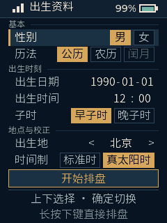
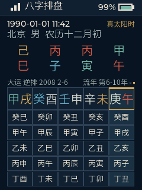

# 八字排盘

本地离线八字排盘，支持四柱、10 个大运和每位大运对应的 10 年流年。

## 出生资料

出生资料使用单页 8 行编辑，不进入独立的多级表单：

1. 性别。
2. 历法：公历、农历、闰月三态循环。
3. 出生日期：年、月、日三个分段。
4. 出生时间：小时、分钟两个分段。
5. 子时规则：早子时或晚子时。
6. 出生地：支持 10 个城市，切换城市时同步经度。
7. 时间模式：标准时或真太阳时，默认真太阳时。
8. 开始排盘。

默认资料为 `1990-01-01 12:00`。日期按当月实际天数校验，切换年份或月份后，
超出当月天数的日期会自动收敛；分钟每次调整 1 分钟。资料只在本次开机期间
保留，不写入 NVS。

### 编辑按键

| 操作 | 资料行 | 日期、时间或出生地编辑中 |
| --- | --- | --- |
| 上/下短按 | 选择上一行或下一行 | 增加或减少当前分段 |
| 确定短按 | 切换选项或进入编辑 | 进入下一分段；末段结束后回到行选择 |
| 下键长按 | 立即排盘 | 立即排盘 |
| 确定长按 | 返回启动器 | 返回启动器 |

## 命盘

- 年、月、日、时四柱使用 20px 干支，四柱区域不绘制表格线。
- 显示公历时间、出生地、性别和对应农历日期。
- 盘面为 5 列大运 × 5 行流年，共展示 5 个大运和当前流年窗口。
- 大运干支使用 20px，流年使用 13px。
- 标题左侧显示起运年份和选中大运的实际十年范围，例如
  `起运1997 大运2017-2026`。
- 标题右侧显示当前流年页范围，例如 `流年6-10`，并用两个页码点标记位置。
- 默认选中当前大运和包含当前年份的流年页。
- 选中大运使用顶部强调条和整列浅底；当前流年使用强调边框，
  该边框仅在选中当前大运时显示。
- 每次展示 5 个大运、5 个流年，左右两组窗口分别翻页查看完整 10 项。
- 命盘不显示十神、藏干、五行分布或日主等扩展信息。

### 查看按键

| 操作 | 动作 |
| --- | --- |
| 上/下长按 | 选择上一位或下一位大运；选中项到窗口边缘后才滑动大运列 |
| 上/下短按 | 切换流年页 |
| 确定短按 | 回到当前大运与当前流年页 |
| 确定长按 | 返回出生资料页，保留原输入以便重新排盘 |

## 数据与范围

- 排盘支持 1900–2100 年。
- 公历、农历、闰月、干支、大运和流年计算全部在设备本地完成。
- 八字不依赖天气、每日一句、网络时间服务或小智语音服务。
- 当前小智语音尚未接入八字排盘指令，排盘需要在应用内完成。
