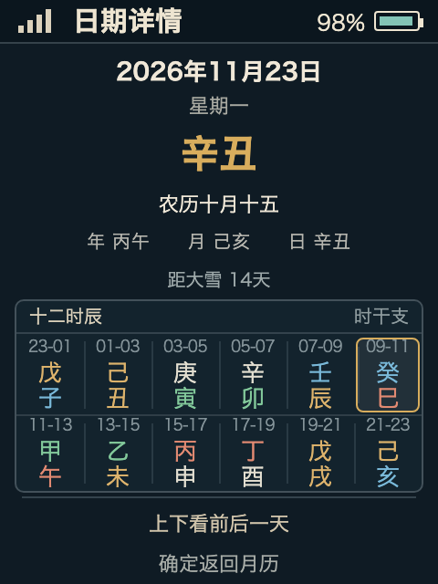

# 万年历日期详情：十二时辰设计



## 目标

在“万年历 → 选择日期 → 确定 → 日期详情”页面下方，加入所选日期的十二时辰时柱。六个时辰为一行，共两行，每个时辰的干支采用天干在上、地支在下的结构。

该区域用于查看，不增加时辰选择操作。返回月历和上下切换前后日期的现有按键方式保持不变。

## 数据

每个时辰内部包含：

- 时间范围：23–01、01–03……21–23。
- 时干：根据所选日期的日干和时支计算。
- 时支：固定按十二辰顺序排列。

“子时、丑时”等名称只用于内部计算和说明，不再显示在每个格子的顶部。用户通过时间范围识别对应时辰。

以 2026-11-23（辛丑日）为例：

| 行 | 时辰与时干支 |
| --- | --- |
| 第一行 | 子时 23–01 戊子 · 丑时 01–03 己丑 · 寅时 03–05 庚寅 · 卯时 05–07 辛卯 · 辰时 07–09 壬辰 · 巳时 09–11 癸巳 |
| 第二行 | 午时 11–13 甲午 · 未时 13–15 乙未 · 申时 15–17 丙申 · 酉时 17–19 丁酉 · 戌时 19–21 戊戌 · 亥时 21–23 己亥 |

## 页面布局

保留当前日期详情的上半部分并适当压缩：

- 日期、星期、日干支、农历和年月日三柱继续显示。
- 今日交节与下一节气合并为一行；没有交节时只显示下一节气倒计时。
- 下半部分改为十二时辰卡片。

### 时辰卡片

- 卡片横跨屏幕，左右各留 8px。
- 标题行左侧为“十二时辰”，右侧为弱化的“时干支”。
- 表格为 `6 列 × 2 行`，每列宽度约 36px。
- 每个单元格从上到下显示：时间范围、时干、时支。
- 时干与时支分别判断五行，并使用当前主题对应的木、火、土、金、水颜色；
  两者不共用一个固定颜色。
- 时干支使用上下结构，例如：

```text
09–11
癸
巳
```

- 时干与时支分别按各自的五行着色；时间范围使用更小的弱化字体。
- 当前查看日期为今天时，以当前小时对应的时辰增加主题色边框和轻背景；其他日期不显示当前时辰强调。

## 按键

- 上键短按：查看前一天。
- 下键短按：查看后一天。
- 确定键短按：返回月历。
- 长按确定：返回上层页面。

不增加时辰焦点或左右移动，因为该区域是当前日期的信息展示，不是编辑控件。

## 实现边界

- 复用八字历法已有的干支计算，不另写一套推算规则。
- 十二时辰固定由时支顺序生成，时干严格依赖所选日期日干。
- 时干计算使用 `((日干序号 % 5) × 2 + 时支序号) % 10`，与节气、真太阳时等
  八字排盘输入解耦，只为公历日期详情提供通行的时柱展示。
- 天干和地支分别按字面五行查色：甲乙寅卯为木，丙丁巳午为火，
  戊己辰戌丑未为土，庚辛申酉为金，壬癸亥子为水。
- 仅在日期详情页创建时辰标签，返回月历后释放。
- 屏幕空间有限，不使用独立卡片包装每个时辰，只绘制一个整体边框和行列分隔线。
- 深浅主题分别使用现有正文色和弱化色，不引入新的大面积背景色。

## 验收要点

- 六个时辰在同一行，共两行，完整显示十二时辰。
- 每个时辰的时干在时支上方，时间范围不遮挡干支。
- 同一格内时干、时支按各自五行显示不同颜色。
- 子时按 23:00–00:59 计算，丑时从 01:00 开始。
- 所选日期的日干变化时，十二组时干同步变化。
- 今天查看时只高亮当前时辰；查看其他日期时不高亮。
- 240×320 屏幕内不出现滚动、重叠或文字截断。
