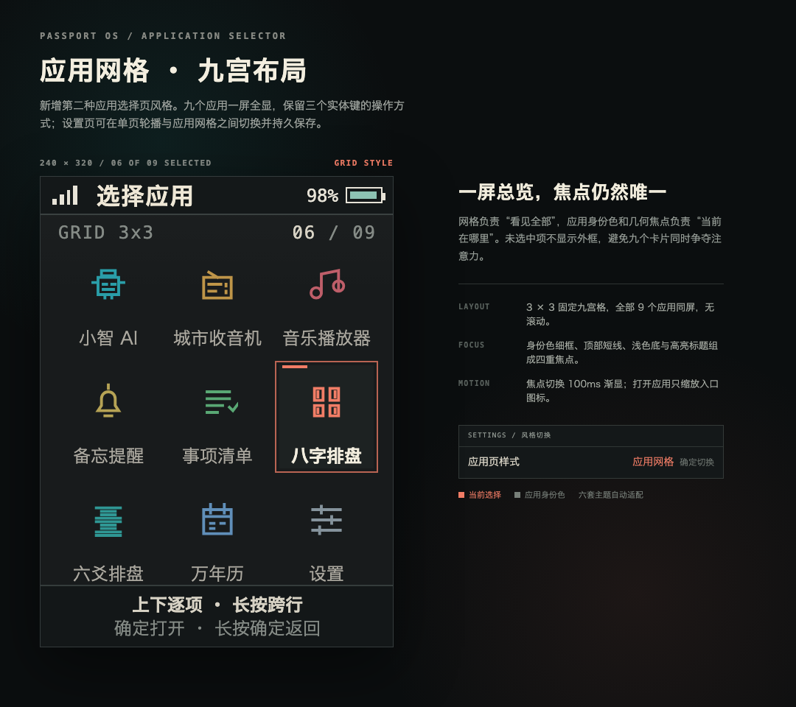
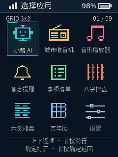

# 应用选择页：应用网格风格

状态：已实现；主机回归、ESP-IDF 5.5.3 构建、合并镜像、分区和 SRAM 检查通过。
应用网格已烧录真机并通过串口事件、屏幕截图和重启持久化检查；实体按键手感仍需人工确认。

## 目标

在现有 Passport Flow 单页轮播之外，增加可切换的“应用网格”风格。
两种风格共用应用注册表、应用身份色、顶部状态栏、实体键和打开逻辑，
只在信息密度、焦点表达和切换动画上不同。





## 风格定义

当前 9 个应用采用固定 `3 × 3` 九宫格：

```text
小智 AI       城市收音机    音乐播放器
备忘提醒      事项清单      八字排盘
六爻排盘      万年历        设置
```

网格风格强调“一屏总览”：

- 所有应用同时可见，不横向或纵向滚动。
- 图标保留各应用身份色，背景保持当前整机主题。
- 未选中项没有底板和外框，只显示彩色图标和较弱的应用名称。
- 当前项使用应用身份色细框、顶部短线、低透明度表面底和高亮标题。
- 顶部继续显示 Wi‑Fi、电池和“选择应用”，不增加独立标题栏。
- 底部显示两行实体键说明，不提供触屏按钮。

### 尺寸

以 `240 × 320` 屏幕为基准：

| 区域 | 尺寸与位置 |
| --- | --- |
| 共享顶栏 | `240 × 26`，顶部 |
| 模式信息行 | y=31，左侧 `GRID 3x3`，右侧当前序号 |
| 应用网格 | x=14，y=48，宽 212px，3 列 |
| 单格 | `64 × 70`，列间距 10px，行间距 10px |
| 图标绘制区 | `48 × 48`，透明底，不常驻外框 |
| 图标图形 | 28×28，沿用现有像素/直线图标 |
| 应用名称 | 12px，单行居中 |
| 底部按键说明 | y=280 起，高 40px，两行 |

固定 3 列可以让 5 个字的“城市收音机”保持完整显示。名称使用现有
`launcher_font_12`，图标继续复用应用身份色与像素图标绘制，不增加图片资源。

## 焦点

焦点不能只靠颜色表达。当前项同时具备：

1. 1px 应用身份色外框，包住当前应用格。
2. 左上 17×2px 身份色短线。
3. 低透明度表面底。
4. 当前图标恢复完整亮度，其余图标降到 70% 透明度。
5. 标题从次级文字色切换为正文色并加粗。

焦点切换采用 100ms 背景和文字渐显。当前项到达网格边界时不循环移动图标位置；
网格始终稳定，用户只感知焦点变化。

## 按键

| 操作 | 动作 |
| --- | --- |
| 上键短按 | 选择阅读顺序中的上一个应用，第一项回绕到最后一项 |
| 下键短按 | 选择阅读顺序中的下一个应用，最后一项回绕到第一项 |
| 上键长按 | 在同一列向上跨一行；第一行回绕到该列最后一项 |
| 下键长按 | 在同一列向下跨一行；最后一行回绕到该列第一项 |
| 确定短按 | 打开当前应用 |
| 确定长按 | 返回首页，继续使用全局返回规则 |

短按只移动一个焦点，长按跨一行。若目标列为空，使用现有网格规则选择最近的
可用项；当前 9 个应用全部填充，因此实际不会遇到空位。

打开应用时只对当前 48px 图标做 140ms 收缩，不再缩放整页。网格风格没有大页
滑动，因此也不申请整页缩放缓冲。

## 风格切换

设置页新增一行：

```text
应用页样式          单页轮播 / 应用网格
```

放在“首页样式”之后，值只在两种风格间循环：

```text
Passport Flow 单页轮播
应用网格
```

规则：

- 默认保留 `Passport Flow`，现有用户升级后视觉不突变。
- 选中“应用网格”后立即写入 NVS，下一次返回应用选择页时使用新风格。
- 当前应用序号在两种风格间共享，切换后停留在同一应用。
- 恢复默认设置时回到 `Passport Flow`。
- 主题不单独保存到启动器；网格继续读取当前 `UI_*` 语义颜色。

## 实现方案

### 数据与 API

新增：

```text
main/launcher/launcher_style.h
```

```cpp
typedef enum {
    LAUNCHER_STYLE_FLOW = 0,
    LAUNCHER_STYLE_GRID = 1,
    LAUNCHER_STYLE_COUNT
} launcher_style_t;

const char *launcher_style_name(launcher_style_t style);
```

在 `settings.h/.cc` 中增加：

```cpp
launcher_style_t settings_get_launcher_style();
```

NVS 继续使用 `system_prefs`，新增键：

```text
launcher_style = 0 | 1
```

读取时校验枚举范围，非法值回退到 `LAUNCHER_STYLE_FLOW`。

### Launcher 结构

当前实现先在现有 `launcher.cc` 内保留统一门面和两套视图，负责：

- 读取当前风格。
- 在风格变化时销毁旧视图并创建新视图。
- 保存共享选中序号和应用打开调用。
- 统一更新 Wi‑Fi、电池状态。

后续如继续增加风格，再把纯视觉实现拆成：

```text
launcher_flow.cc   // 现有 Passport Flow
launcher_grid.cc   // 新增九宫格
launcher_icons.cc  // 两套风格共享图标色板和绘制
```

当前首版采用同文件实现，已增加 `build_grid_ui_locked()`、
`apply_grid_tile_style()`、`grid_move_selection()` 和
`grid_start_entry()`。应用注册表和 `app_registry_switch_to()` 未改。

### Launcher 门面

```cpp
launcher_style_t rendered = LAUNCHER_STYLE_FLOW;
size_t selected_app = 0;

void launcher_ui_show(void) {
    const launcher_style_t wanted = settings_get_launcher_style();
    if (s_screen == nullptr || wanted != rendered) {
        destroy_current_launcher();
        rendered = wanted;
        if (rendered == LAUNCHER_STYLE_GRID) {
            grid_create(selected_app);
        } else {
            flow_create(selected_app);
        }
    }
    show_current_launcher();
}
```

两种视图都需要提供：

```text
create(selected_index)
show()
hide()
destroy()
on_key(button, event)
update_status()
selected_index()
requested_app()
```

视图切换期间继续沿用当前 LVGL 锁和 `bsp_lvgl_lock()`，不能在输入任务中直接删除
正在绘制的屏幕。

### Settings 行索引

设置页由 11 行增加为 12 行，窗口仍保持 7 行可见：

```text
音量
屏幕亮度
自动熄屏
外观主题
首页样式
应用页样式       <- 新增
子时规则
按键音效
手机设置
无线网络
网络与时间
恢复默认
```

需要同步调整：

- `kRowCount`：`11 → 12`。
- 设置行标签和提示数组。
- “恢复默认”索引及确认框显示条件。
- 首页样式以后所有 switch 分支的索引。
- 恢复默认时把 `launcher_style` 写回 `LAUNCHER_STYLE_FLOW`。

### 网格焦点映射

当前 9 个应用固定为 3 列：

```cpp
short click:
    selected = (selected + delta + 9) % 9;

long press:
    selected = (selected + delta * 3 + 9) % 9;
```

网格绘制位置由 `selected % 3` 与 `selected / 3` 直接决定，不维护第二套索引。

### 资源与内存

- 不新增位图、字体和帧缓冲。
- 图标继续使用 LVGL draw callback。
- 两套风格互斥创建；切换时先隐藏旧视图，再删除旧对象。
- 网格风格比现有 9 张完整轮播卡更轻，不应对最大连续块造成新的峰值。
- 极低内存时只收缩 48px 图标；若图标动画也无法执行，直接打开应用。

## 测试计划

已新增 `tests/test_launcher_grid_ui.py`，静态检查：

- 3×3、9 个应用、无分页和滚动对象。
- 每格 `64 × 70`，网格不越过顶部和底部安全区。
- 短按步长为 1，长按步长为 3，均首尾回绕。
- 当前项的边框、短线、背景和文字状态同时存在。
- 网格不创建应用描述、二维码或底部说明之外的额外大卡片。
- 网格与 Flow 使用同一应用注册表、身份色和打开入口。

扩展 `tests/check_launcher_apps.py`：

- 所有应用名称仍能由 `launcher_font_12` 完整覆盖。
- 九宫格的 5 字标题不超出 64px。

设置测试：

- `launcher_style` 可写入、重启恢复。
- 非法 NVS 值回退到单页轮播。
- 恢复默认后回到单页轮播。
- 风格切换后仍保持当前应用序号。

真机验收：

- 六套主题下九个图标和名称均可辨认。
- 八字排盘（身份色朱砂）与设置（灰蓝）在深色、浅色主题中焦点清晰。
- 短按逐项、长按跨行、首尾回绕和确定打开正常。
- 从六爻、八字返回后立即切到收音机或音乐，无黑屏、卡死或看门狗复位。
- 切换风格后不重启、不丢失当前选中应用。

## 不纳入本次方案

- 不做 Touch 操作。
- 不增加左右实体键语义。
- 不做滑动分页。
- 不在网格中恢复应用说明文字。
- 不把设置移出应用注册表。
